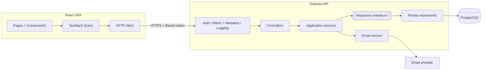
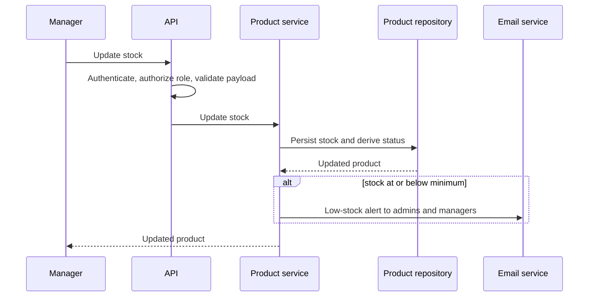
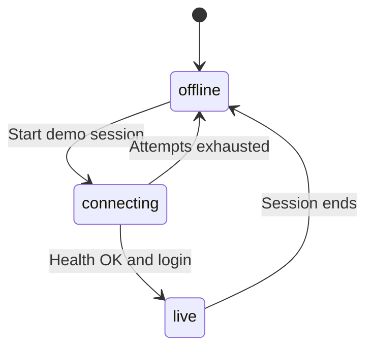
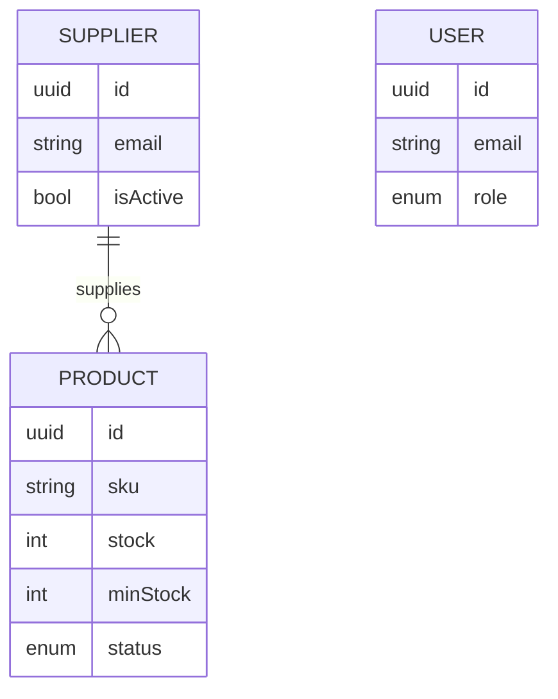

<h1 align="center">📦 InventorySystem — Full-stack inventory management with RBAC</h1>

<p align="center">
  <a href="https://inventory-system-five-steel.vercel.app"></a>
  <a href="https://agusdev-portfolio.vercel.app/proyectos/intelligent-inventory-system"></a>
  
  
</p>

<p align="center">
  <code>React 19</code> <code>TypeScript</code> <code>TanStack Query</code> <code>Express</code> <code>Prisma</code> <code>PostgreSQL</code> <code>Zod</code> <code>Jest</code> <code>Vitest</code> <code>Docker</code> <code>GitHub Actions</code>
</p>

> **Technical case study.** The source code is private. This document covers architecture, key decisions and selected code excerpts. Happy to do a live code walkthrough in an interview.

<details>
<summary><b>🤖 Summary for LLMs / AI assistants</b></summary>

<br/>

```yaml
project: InventorySystem — full-stack inventory management web app for small businesses
url: https://inventory-system-five-steel.vercel.app
author: Agustín Alanís (github.com/agustinalanis)
role: Sole developer — design, frontend, backend, database, testing, CI/CD, deployment
timeline: December 2025 – January 2026, with improvements through July 2026 (77 commits)
code_visibility: Private; this repo is a technical case study

stack:
  frontend: React 19, TypeScript, Vite, TanStack Query, React Router, Tailwind CSS
  backend: Node.js 20, Express, TypeScript, Zod, Winston, Swagger/OpenAPI
  data: PostgreSQL, Prisma ORM
  auth: JWT access + rotating refresh tokens, bcrypt
  email: Resend
  testing: Jest + Supertest (97 backend tests), Vitest + React Testing Library (49 frontend tests)
  infrastructure: Docker multi-stage builds, Docker Compose, GitHub Actions CI, Vercel, Render

features:
  - Products, suppliers and users with three roles (ADMIN, MANAGER, VIEWER)
  - Dashboard with aggregated stock metrics
  - Per-product minimum stock with email alerts to admins and managers
  - Instant demo mode that switches to live data once the backend is awake

key_engineering:
  - Hexagonal architecture: domain contracts, application services, infrastructure adapters
  - Role-based access control on every route
  - Short-lived access tokens with refresh token rotation and logout invalidation
  - Dashboard metrics computed with parallel, database-side aggregations
  - Email alerts isolated so failures never block a stock update
  - CI pipeline with PostgreSQL service, migrations, unit + integration tests and Docker builds

skills_demonstrated: full-stack TypeScript, clean/hexagonal architecture, authentication and authorization, automated testing, CI/CD, Docker, production deployment
```

</details>

---

## 📌 Overview

InventorySystem is a full-stack web app for small businesses to manage their stock. I built it **end-to-end, as the sole developer**: design, frontend, backend, database, tests, CI/CD and deployment.

- **Products, suppliers and users**, with three roles: `ADMIN`, `MANAGER` and `VIEWER`
- **Dashboard** with stock status, categories and low-stock products
- **Low-stock email alerts** based on a minimum stock set per product
- **Demo mode** that responds instantly, even while the backend is waking up

**Timeline:** December 2025 – January 2026, with improvements through July 2026 · 77 commits

---

## 🏗️ Architecture

The backend follows a **hexagonal architecture**: the domain defines entities and contracts, the application layer holds the use cases, and the infrastructure layer implements Express, Prisma and email delivery.



### Updating stock



### Demo mode



### Data model



- **UUIDs** and **indexes** on `category`, `status` and `supplierId`, the fields used to filter listings.
- **Status is derived from stock** (zero stock becomes `OUT_OF_STOCK`); `DISCONTINUED` is set manually.
- **The alert threshold is per product**, not global.
- Suppliers can be **deactivated** instead of deleted.

---

## 🧠 Key technical decisions

| Decision | Instead of | Why |
|---|---|---|
| **Hexagonal architecture** | Business logic inside controllers | Use cases depend on interfaces, so unit tests inject mocks without a database |
| **Zod at the HTTP boundary** | Manual validation | One schema per operation and consistent error messages |
| **15-minute access tokens + refresh token rotation** | A single long-lived token | Shrinks the window in which a leaked token can be used |
| **Parallel, database-side aggregations** for the dashboard | Aggregating in memory from a full listing | Counts, groupings and stock-vs-minimum comparisons run in SQL |
| **Demo mode with an in-memory store** synced to the backend | Relying on an always-on server | The demo never breaks while the server is waking up |
| **Separate deployments** (Vercel + Render) | A single host | Each layer uses the platform that fits it best |

---

## 🔐 Security

- Passwords hashed with **bcrypt**
- **15-minute access tokens**; refresh tokens checked against the stored one, **rotated on every use** and invalidated on logout
- **Role-based access control** on every route: all authenticated users can read, `ADMIN` and `MANAGER` can write, only `ADMIN` can delete
- **Zod validation** on request bodies and query strings
- **Uniform login response** that never reveals whether the email or the password was wrong
- Generic error messages in production
- CORS restricted to configured origins
- Parameterized queries through Prisma

---

## 🧩 Challenges

### 1. A stable demo on a backend that sleeps

**Problem.** The free-tier backend takes a while to wake up, and the demo was unusable in the meantime.

**Solution.** An in-memory store with role-based permissions answers immediately. In parallel, the client polls the health check with exponential backoff (up to 12 attempts, capped at 10 s), logs in for real and invalidates the cached queries.

**Result.** The demo feels instant and switches to live data once the server is ready. The session module and the store are covered by tests.

### 2. Stock alerts that never block operations

**Problem.** Sending an email must never block or break a stock update.

**Solution.** Email delivery is isolated: if it fails, or no provider is configured, the error is logged and the operation continues. Alerts go to every `ADMIN` and `MANAGER`.

**Result.** Stock always updates, and alerts arrive whenever the email service is available.

---

## 🧪 Testing, CI/CD & deployment

- **97 backend tests:** 36 unit tests (auth, product and supplier services) and 61 integration tests with Supertest against PostgreSQL
- **49 frontend tests** with Vitest and React Testing Library: common components, auth and demo hooks, login page and demo module
- **CI with GitHub Actions:** spins up PostgreSQL, applies migrations, runs unit and integration tests, and builds backend, frontend and Docker images on every push and pull request
- **Docker:** multi-stage Dockerfiles for backend and frontend, plus Docker Compose with the database and health checks
- **Deployment:** frontend on Vercel, backend on Render, managed PostgreSQL
- **API documented** with Swagger/OpenAPI

---

## 💻 Code excerpts

<details>
<summary><b>Role-based access control</b></summary>

```ts
export const authorize = (...roles: UserRole[]) => {
  return (req: AuthRequest, _res: Response, next: NextFunction) => {
    if (!req.user) {
      return next(new UnauthorizedError('Not authenticated'));
    }
    if (!roles.includes(req.user.role)) {
      return next(new ForbiddenError('Insufficient permissions'));
    }
    next();
  };
};

router.use(authenticate);
router.get('/', validateQuery(productFiltersSchema), productController.getProducts);
router.post('/', authorize(UserRole.ADMIN, UserRole.MANAGER),
  validate(createProductSchema), productController.createProduct);
router.delete('/:id', authorize(UserRole.ADMIN), productController.deleteProduct);
```
</details>

<details>
<summary><b>Dashboard in a single round of queries</b></summary>

```ts
const [totalProducts, productsByStatus, lowStockProducts, productsByCategory] =
  await Promise.all([
    prisma.product.count(),
    prisma.product.groupBy({ by: ['status'], _count: { status: true } }),
    prisma.product.findMany({
      where: { stock: { lte: prisma.product.fields.minStock } },
      select: { id: true, name: true, sku: true, stock: true, minStock: true },
      orderBy: { stock: 'asc' },
      take: 10,
    }),
    prisma.product.groupBy({
      by: ['category'],
      _count: { category: true },
      orderBy: { _count: { category: 'desc' } },
      take: 10,
    }),
  ]);
```

The four queries run in parallel, and the low-stock comparison is resolved in the database by comparing two columns.
</details>

<details>
<summary><b>Cancelable retries with exponential backoff</b></summary>

```ts
async function sleep(ms: number, signal: AbortSignal): Promise<void> {
  await new Promise<void>((resolve, reject) => {
    const timeoutId = window.setTimeout(resolve, ms);
    signal.addEventListener('abort', () => {
      window.clearTimeout(timeoutId);
      reject(new DOMException('Aborted', 'AbortError'));
    }, { once: true });
  });
}

for (let attempt = 0; attempt < MAX_SYNC_ATTEMPTS; attempt += 1) {
  if (abortController.signal.aborted) return;
  if (await pingHealth(abortController.signal)) {
    // authenticate and switch the connection status to 'live'
    return;
  }
  const delay = Math.min(1000 * 2 ** attempt, 10000);
  await sleep(delay, abortController.signal);
}
setDemoConnectionStatus('offline');
```

If the user leaves the demo, the pending wait is canceled immediately instead of running in the background.
</details>

---

<p align="center">
  <a href="https://github.com/agustinalanis">← Back to profile</a> · <a href="mailto:agusalanis.dev@gmail.com">agusalanis.dev@gmail.com</a>
</p>
